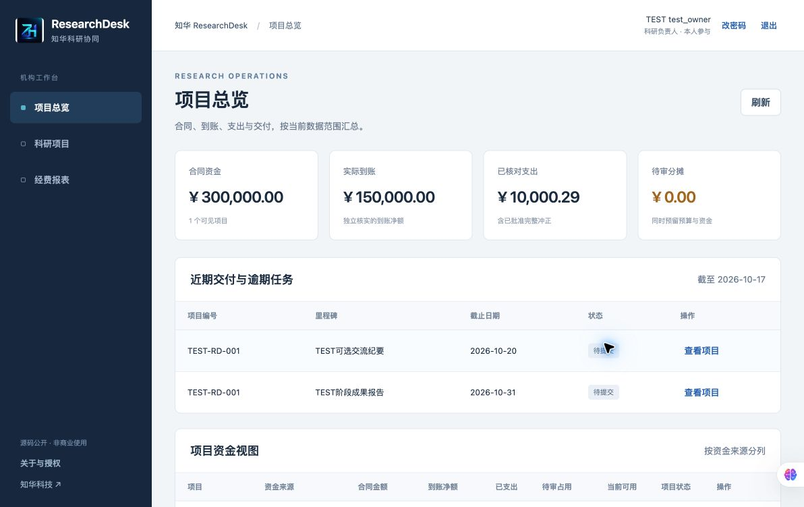
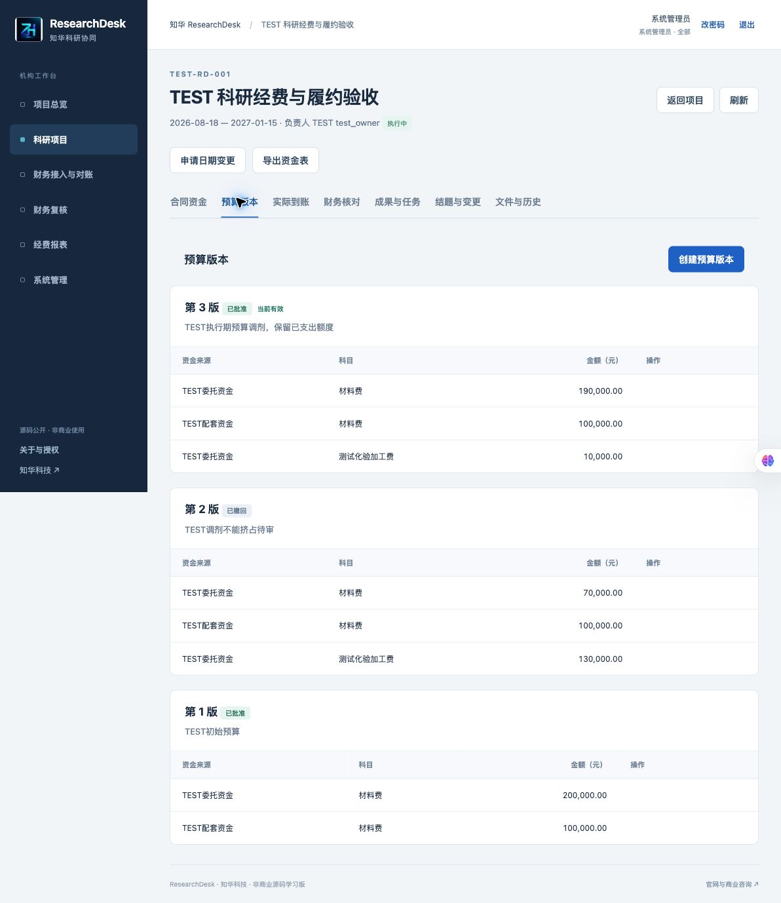
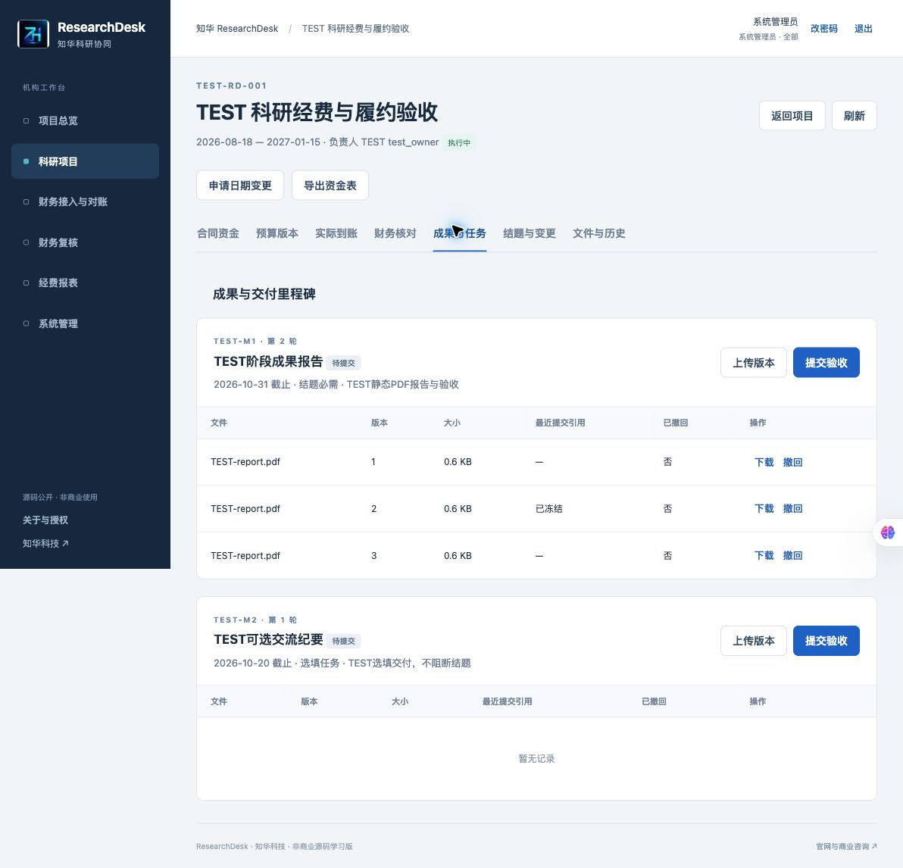

[中文](README.md) | [English](README.en.md)

# ResearchDesk · Research Funding and Project Delivery Coordination

**ZhiHua Technology (Shanghai Rujing Zhihua Information Technology Co., Ltd.)** · [Official website](https://www.zhuatech.cn/)

A Java 21, Spring Boot, Vue 3 and MySQL workspace connecting research contracts, budget revisions, actual funding receipts, finance ledger allocations, deliverable acceptance and closeout evidence. Designed for one institution with multiple departments and modest workloads.

**Source available for personal learning and exchange only. Commercial use without authorization from Shanghai Rujing Zhihua Information Technology Co., Ltd. is prohibited.** Commercial licensing, private deployment and customization require separate written authorization. See [LICENSE](LICENSE).

## Scenarios and roles

For research institutes, university departments and corporate research centers coordinating tasks and funding. Investigators prepare projects, budgets and deliverables; research administrators independently review activation, budgets, schedule changes and deliverables; finance operators import offline ledger files, register receipts and allocate expenses; finance reviewers independently verify transactions. Administrators manage accounts, departments, roles, expense categories, menus, parameters and column mappings.

User and administrative functions share one same-origin web application, with role-specific menus and server-side permissions. Visibility supports all projects, the current department, or owned/assigned projects. A different account must review a submitted record, including submissions by administrators.

## Implemented features

- Project search, status filtering, sorting, pagination, draft CRUD, activation review, withdrawal and project membership.
- Multiple funding sources, contract amounts and actual evidence files; budgets by source and category, with independently approved revisions.
- Registration and complete reversal of offline receipts. Only approved receipts increase net cash; reversal cannot underfund approved expenses or pending reservations.
- UTF-8 CSV / XLSX ledger imports with configurable headers, file digests and unique voucher/line keys. A bad row rejects the entire batch; formulas and multiple worksheets are rejected.
- Exact expense allocation across several sources/categories within one project. Both budget limits and actual receipts are checked. Pending allocations reserve capacity; rejection releases it.
- Append-only complete reversals retaining original ledger and allocation records. Unrelated entries require a reason and independent exclusion approval.
- Milestones, actual PDF / PNG / JPEG files, named file versions, frozen submissions, independent acceptance, requests for changes and revision rounds. Project/milestone date changes require independent approval.
- Closeout blockers, residual-fund plans, frozen snapshots, independent approval and ZIP packages with budget, schedule and approval records. Reopening retains earlier snapshots and original files.
- Scoped reports, approaching/overdue milestones, financial CSV exports, project history and administrative audit. Money is stored as integer cents and transmitted as JSON strings.
- Session login, CSRF, failed-login throttling, BCrypt, immediate account/department deactivation and password-based session revocation.

See [business rules](docs/business.md) and [operations](docs/operations.md). File imports do not constitute integration with accounting, banks, OA or sponsor platforms.

## Current application screenshots

Screenshots contain independent TEST acceptance data, without real institutional, customer or finance records. These records are not default database seeds.

| Page | Function |
| --- | --- |
| [Login](docs/screenshots/login.jpg) | Institutional account access |
| [Overview](docs/screenshots/overview.jpg) | Scoped funding and deadlines |
| [Budgets](docs/screenshots/budgets.jpg) | Source/category budget revisions |
| [Finance](docs/screenshots/finance.jpg) | Original entries and reconciliation status |
| [Milestones](docs/screenshots/milestones.jpg) | File versions and acceptance |
| [Reports](docs/screenshots/reports.jpg) | Funding balances and reservations |
| [Accounts](docs/screenshots/accounts.jpg) | Administrative accounts, roles and scope |
| [Settings](docs/screenshots/settings.jpg) | Deadline window and file capacity |





## Architecture

```text
User/admin Vue 3 pages → same-origin Nginx → Spring Boot 4 / Java 21
                                          ├─ Security sessions + CSRF
                                          ├─ JPA transactions + versions + write guard
                                          └─ Flyway → MySQL 8.4 (records + private files)
```

Backend: Spring Boot 4.0.7, Hibernate JPA, Flyway, Apache POI 5.5.1 and PDFBox 3.0.8. Frontend: Vue 3.5.43 and Vite 8.1.5. File bytes and metadata share database transactions for consistent small-scale backups. Writes use an instance coordination row; large-scale concurrency is not promised. See [architecture](docs/architecture.md).

## Repository layout

```text
backend/  Java business logic, REST, security, JPA and tests
  src/main/resources/db/migration/V1__researchdesk.sql
frontend/ Vue pages, forms, exact-money helpers and official logo
docs/     Business, architecture, API, operations, deployment, security, screenshots
scripts/  Private environment creation, HTTP checks, backup/restore, release checks
.github/workflows/quality.yml  Quality and fresh-database acceptance
compose.yaml / compose.storage.yaml / .env.example / LICENSE / NOTICE
```

## Requirements

- Docker Engine / Docker Desktop and Docker Compose v2; access to required image, Maven and npm registries.
- For source development: JDK **21**, Maven **3.9**, Node.js **24.19.0+**, npm and MySQL **8.4**. Python **3.11+** is used for initialization and acceptance scripts.
- Default access is restricted to `127.0.0.1:8172`. Database and backend have no host-published ports. Validate resource needs and capacity in the target environment.

## Installation, startup and database initialization

```bash
git clone https://github.com/zhuatech-han/zhuatech-researchdesk.git
cd zhuatech-researchdesk
python3 scripts/init-env.py
docker compose -p researchdesk config --quiet
docker compose -p researchdesk up --build -d --wait --wait-timeout 900
```

Open the [local workspace](http://127.0.0.1:8172/) and [health endpoint](http://127.0.0.1:8172/actuator/health). The initial username is `ADMIN_USERNAME` in `.env` (default `admin`). The setup script generates a random password in the private local `.env` as `ADMIN_PASSWORD`; there is no shared default password. Existing environment files are never overwritten.

Flyway initializes a new database using `V1__researchdesk.sql`. Bootstrap creates the administrator, six roles, menus, six budget categories, standard column mapping and system parameters. **No research projects, finance entries or deliverables are seeded.** Restarting does not reset passwords or overwrite business records. Keep applied migrations immutable and use new migrations for changes.

The `mysql-data` named volume stores records and private file bytes. Use `docker compose -p researchdesk down` for ordinary shutdown. `down -v` deletes the selected instance's data and is only suitable for intentionally disposable test environments.

## Configuration

| Variable | Purpose |
| --- | --- |
| `MYSQL_ROOT_PASSWORD` | Private database administration password |
| `DATABASE_PASSWORD` | Application database password, matching the MySQL user |
| `ADMIN_USERNAME` / `ADMIN_PASSWORD` | First empty-database initialization only |
| `WEB_PORT` / `BIND_ADDRESS` | Web port/binding, default `8172` / `127.0.0.1` |
| `COOKIE_SECURE` | Set to `true` for HTTPS deployment |
| `RESEARCHDESK_MYSQL_DATA_DIR` | Empty dedicated absolute directory for the optional storage override only |
| `DATABASE_URL` / `DATABASE_USER` | Optional backend connection overrides; container MySQL is the default |

For port conflicts, change `WEB_PORT` in private `.env` and recreate the services. `.env.example` contains configuration names without credentials. Never commit real passwords. Passwords require 12–72 UTF-8 bytes with uppercase, lowercase and digits.

Administration supports workspace name, 1–90 days of deadline visibility and 10–100 MB per-project capacity (40 MB by default). Files are limited to 3 MB each and 100 versions per project. Finance imports accept at most 1 MB, 500 records and 30 columns. Dates use `YYYY-MM-DD`; amounts are yuan with up to two decimal places. Mappings cover all nine canonical fields. See [API and imports](docs/api.md).

## Testing

```bash
mvn -B -f backend/pom.xml spotless:check clean verify
cd frontend
npm ci --no-audit --no-fund
npm run format:check
npm run lint
npm test
npm run build
cd ..
python3 -m pip install -r scripts/requirements-quality.txt
python3 -m black --check scripts
python3 -m unittest discover -s scripts -p 'test_*.py'
python3 scripts/release-check.py
docker compose -p researchdesk-test config --quiet
docker compose -p researchdesk-test up --build -d --wait --wait-timeout 900
python3 scripts/smoke.py --env-file .env --private-state /tmp/researchdesk-quality-state.json
docker compose -p researchdesk-test down -v
```

The HTTP script requires a fresh business database and creates explicitly marked TEST records and separate test accounts. Never run it against actual business data. Its private state must use a new path outside the repository. Backend coverage includes 25 money/file parsing/JPA workflow/session-security tests, plus 2 frontend precision tests and 6 backup/restore guard tests. See the actual [verification record](docs/verification.md). Docker Maven builds execute tests.

## Deployment, backup and restoration

See [deployment](docs/deployment.md), including optional dedicated host storage for slow external Docker disks. Public deployment requires a controlled domain, HTTPS, Secure cookies, boundary access controls and target-environment acceptance. Default database connections require TLS encryption without production CA/identity verification; external databases should use trusted certificates and `VERIFY_IDENTITY`. Certificates, email, SMS and institutional SSO are not bundled.

```bash
python3 scripts/backup.py --env-file .env --project researchdesk --output /secure/researchdesk-backup.sql
python3 scripts/restore.py --env-file /private/restore.env --project researchdesk-restore-check --input /secure/researchdesk-backup.sql
```

Backups stay outside the repository with mode 600. Restore only accepts an empty, independent `researchdesk-restore-*` instance and refuses to overwrite existing tables. Database dumps include private file bytes: protect access and rehearse restoration regularly.

## Limitations and excluded features

- One institution, CNY and modest single-instance workloads. No multitenancy, multiple currencies, payments, reimbursement processing, statutory accounting, tax assessment, ethics or clinical research management.
- File imports only. No accounting/bank/OA/sponsor APIs, online payments, electronic seals or certified digital evidence.
- Deadline notices appear in the workspace only, showing the earliest 100 visible unaccepted milestones by due date. No background email, SMS, WeChat messages or scheduled push delivery; there is no notification-secret configuration.
- Complete reversals only. For partial corrections, reverse the original in full and import the corrected entry. Receipts do not move money; residual plans do not issue refunds.
- Past milestone rounds retain file versions and audit actions; separate historical acceptance-round packages are not provided. Approved closeout snapshots are the archival record.
- Files undergo format parsing and size checks, not antivirus scanning. Institutional download policies still apply. All historical versions count toward capacity; business file bytes are not physically deleted.
- Lists are bounded at 10,000 records. Summaries and the global write guard target modest workloads, without high-concurrency or large-file guarantees. Disabled menus hide navigation; API permissions remain role-based.
- Actual institutional records, policies and production capacity have not been validated. Target-environment acceptance and commercial authorization are required before actual institutional use.

## Licensing and third-party components

[LICENSE](LICENSE) is the ZhuaTech source-available noncommercial license, restricted to personal learning and exchange. Commercial use without authorization from Shanghai Rujing Zhihua Information Technology Co., Ltd. is prohibited. This project is not MIT/Apache licensed for free commercial use. Third-party components retain their own licenses; see [NOTICE](NOTICE).

## Contact ZhiHua Technology

**ZhiHua Technology (Shanghai Rujing Zhihua Information Technology Co., Ltd.)** · [https://www.zhuatech.cn/](https://www.zhuatech.cn/)

Contact ZhiHua Technology for commercial licensing, private deployment, customization, data migration and system integration.

- Email: [han@zhuatech.cn](mailto:han@zhuatech.cn)
- Email: [jack@zhuatech.cn](mailto:jack@zhuatech.cn)
- WhatsApp: [+86 17521234993](https://wa.me/8617521234993)
